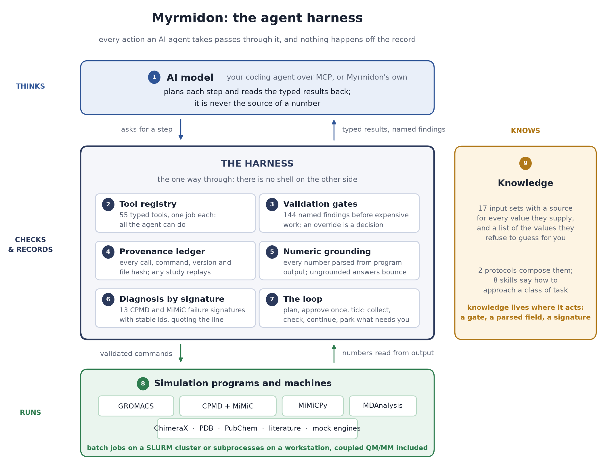

# Myrmidon

**An agent harness for molecular simulation.** Myrmidon puts a typed, gated and fully
recorded tool layer between an AI agent and the simulation programs it drives: GROMACS for
classical molecular dynamics, CPMD coupled to GROMACS through MiMiC for QM/MM, and MiMiCPy
for force matching, on a workstation or on a batch cluster. The coding agent you already
use connects to it over the Model Context Protocol. Every number the agent reports is parsed
from an engine, every expensive step passes a gate, and every study replays from its own
ledger.



```bash
conda create -n myrmidon python=3.11 -y && conda activate myrmidon
git clone https://github.com/13sachin/myrmidon myrmidon && cd myrmidon && pip install ".[analysis]"

myrmidon init                 # write this machine's config (--backend slurm on a cluster)
myrmidon doctor               # which simulation programs were found
cd ~/my-project && myrmidon client
```

The last command makes the directory a Myrmidon project the first time and starts Claude
Code in it, wired to the harness; have Claude Code installed, or wire Cursor, Codex, Qwen
Code or Goose instead with `myrmidon mcp install --client NAME`. Then ask for what you want
in your own words:

> Solvate 1L2Y in a cubic box with 1 nm padding, neutralise, minimise, and run 100 ps of
> NVT at 300 K. Report the mean temperature and the energy drift.

The agent builds the topology, defines the box, solvates, writes the inputs from a named
protocol, submits the runs, reads the energy file and answers with values that name the
file and the command they came from. Nothing in that answer was typed by the model.

## Why a harness

A coding agent can already *perform* a simulation workflow through a shell. What it cannot
do is *guarantee* anything about it: there is no spending limit, no record of what ran, no
way to reproduce it, and no check between the model's assumption and the submitted job.
Myrmidon supplies the missing infrastructure instead of trying to out-think the model.

The division of work it is built for:

- **you** own the scientific question, the budget and the judgement calls;
- **the agent** owns the running, the watching and the bookkeeping;
- **the record** keeps every claim traceable to the program that computed it.

Four guarantees hold for every tool, and the code enforces them rather than asking:

1. **No number comes from the model.** Values are parsed from engine output into typed
   observations; an answer that states a number no tool returned is bounced back.
2. **No silent assumption.** Expensive tools are gated. A blocking finding refuses the
   call; a warning must be acknowledged by its id, in the call or once by the person
   responsible for the study, and the ledger names who accepted it.
3. **Everything is recorded.** Every call lands in the study's append-only ledger with the
   exact command line, engine versions, inputs and outputs by checksum, and the findings it
   raised. Nobody has to remember to keep it.
4. **Every study replays.** `myrmidon replay` reproduces a study from its ledger alone and
   compares checksums, saying which files come back identical and which differ because
   parallel dynamics is not reproducible bit for bit.

## What the agent gets

**One registry, 55 tools.** Each tool does one thing and returns a typed observation.

| family | tools |
| --- | --- |
| GROMACS | `gmx_pdb2gmx`, `gmx_editconf`, `gmx_solvate`, `gmx_genion`, `gmx_make_ndx`, `gmx_genrestr`, `gmx_grompp`, `gmx_mdrun`, `checkpoint_continue`, `gmx_energy`, `series_convergence`, `traj_analyze`, `traj_frames` |
| MiMiC QM/MM | `mimic_select_qm`, `mimic_prepare`, `mimic_run`, `mimic_diagnose` |
| force matching | `fm_collect`, `fm_merge`, `fm_plan`, `fm_fit`, `fm_validate`, `fm_displace_plan`, `fm_frame_report`, `fm_report` |
| jobs | `job_status`, `job_cancel`, `script_run` |
| knowledge | `protocol_lookup`, `inputset_lookup`, `inputset_apply`, `skill_lookup`, `plan_write`, `plan_approve`, `plan_check`, `knowledge_search`, `tool_lookup`, `fetch_pdb`, `lookup` |
| study | `study_create`, `study_open`, `study_report`, `journal_write`, `loop_start`, `loop_tick`, `loop_status`, `loop_answer`, `loop_stop` |
| files, machine | `file_read`, `file_write`, `file_check`, `doctor`, `session_summary` |
| visualisation | `viz_open`, `viz_command` |

**Gates with names.** Every finding a gate can raise has a stable id, a message, the
assumption it protects and a suggestion. A gate asks whether the timestep suits the constraints, whether
the charge of the QM region was stated rather than guessed, whether the wall-clock time
covers the run, whether the ranks fit the box, whether the submission exceeds the study's
budget. An override is a named decision in the record, never a flag quietly passed.

**Diagnoses with names.** When a run fails, `job_status` and `mimic_diagnose` return the
failure by its signature: 13 CPMD and MiMiC patterns and the GROMACS equivalents, each
quoting the line it matched, so an agent or a person reads the cause instead of a
traceback. A run that finished with every step it asked for is never failed by a pattern.

**Knowledge where it acts.** 17 curated input sets carry their parameter values with a
source for each and a list of the values they refuse to supply because they are facts about
your system. Two protocols compose them into named workflows. Eight skills tell the agent
how to approach a class of task with these tools.

**A study you can read back without a model.** `myrmidon status`, `summary`, `report`,
`watch` and `replay` work from the ledger and the job store alone, in any terminal, while
the study runs or years later.

## Unattended studies

The same tools run without anyone at the keyboard. A **plan** states what will run, with
which values and resources, what the harness may do on its own (rerun a failed job once,
extend a stage whose check fails by one segment) and what each step must satisfy. You
approve it once.

```bash
myrmidon run "QUESTION"             # one question, one unattended session (Myrmidon's own agent)
myrmidon tick --follow 60           # advance an approved plan: collect, check, continue, park
myrmidon status                     # where the study stands
myrmidon inbox                      # what waits on a person, with evidence and options
myrmidon answer QUESTION_ID OPTION  # your decision; the next tick carries it out
```

Each pass is crash-only: a pass killed at any instant is picked up by the next. A step that
fails with a known signature is parked as a question with the evidence; one that fails
without a signature is rerun once, since a machine fault does not reproduce. The loop's own
test runs three study shapes end to end on the mock engines: a chain of coupled QM/MM
stages, an equilibration repeated until a criterion holds, and a sweep of single points
joined into one table (`tests/reference_campaign/`).

With a model endpoint of your own, `myrmidon` alone starts Myrmidon's native agent on the
same registry; it needs the `agent-pydantic` and `agent-cli` extras (`myrmidon endpoints`,
[docs/GETTING_STARTED.md](docs/GETTING_STARTED.md)).

## Agents, engines and machines

**Agents.** `myrmidon client` starts Claude Code wired to the harness; `myrmidon mcp
install --client NAME` writes the configuration for Claude Code, Cursor, Codex, Qwen Code
and Goose, which speak the same protocol.

**Engines.** GROMACS, CPMD built with MiMiC support, and mimicpy come from their own
projects and must be on the machine; `myrmidon doctor` reports which were found. On a
cluster where they are loaded with `module load`, name that script as `env_script` in the
machine config and the server, the doctor and every batch script source it themselves;
`myrmidon serve --check` proves it from a bare shell.

**Machines.** `myrmidon init` writes the machine config: engines, `backend = local` or
`slurm`, partition and account, where studies live. Nothing in the repository knows your
machine. Without a scheduler, jobs run as subprocesses with every gate, ledger entry and
replay intact, and the core count is checked against each submission. Without any engine,
`myrmidon serve --mock` runs the whole workflow against stand-in programs with invented
numbers, which is also how the test suite runs anywhere.

## The tutorial

[docs/TUTORIAL.md](docs/TUTORIAL.md) walks the tool through one system, acetone in water,
from the MiMiC project's own tutorial inputs: the classical box, the coupled QM/MM chain,
the reference single points and a force-matching fit, then the same work unattended under
a plan, and how a study is read back. It shows how work is asked for, what the harness does
with the request, where it refuses, and what it leaves behind.

| stage | you need |
| --- | --- |
| the classical box | GROMACS |
| the coupled QM/MM chain and the reference single points | GROMACS and a MiMiC-enabled CPMD, with mimicpy |
| the force-matching fit | GROMACS and mimicpy, no quantum program |
| the whole shape with invented numbers | nothing: the mock engines |

Every step of it is asked for in your agent's session, in your own words, and every step
is answered from the tools: the tutorial shows what the agent calls, what the harness
refuses, and what the study holds afterwards.

## Command reference

| command | what it does |
| --- | --- |
| `myrmidon` / `myrmidon chat` | the native agent on your own model endpoint |
| `myrmidon client` | your coding agent, wired to the harness, in this project |
| `myrmidon init`, `doctor`, `serve --check` | the machine: config, engines, proof from a bare shell |
| `myrmidon init-project DIR`, `mcp install` | make a repository a project; wire a client |
| `myrmidon run`, `tick`, `status`, `inbox`, `answer`, `approve` | unattended studies |
| `myrmidon study`, `plan`, `inputset`, `tools`, `call` | studies, plans, curated inputs, any tool from the shell |
| `myrmidon watch`, `summary`, `report`, `replay`, `fm-report` | read a study back, live or after the fact |
| `myrmidon endpoints`, `sessions`, `statusline` | model endpoints, saved sessions, a status-bar line |

## Documentation

- [docs/GETTING_STARTED.md](docs/GETTING_STARTED.md): installation and configuration in full
- [docs/TUTORIAL.md](docs/TUTORIAL.md): running Myrmidon, from a molecule to a force-matching fit
- [docs/FORMATS.md](docs/FORMATS.md): the study directory, the ledger, the plan and the loop's files
- [CHANGELOG.md](CHANGELOG.md): what each version contains

## Direction

Myrmidon is built towards studies that answer a research question without anyone at the
keyboard: a question in the language of the field, a plan a person approves once, runs that
submit, check and continue themselves, and a report whose every value names its source. The
MCP server with a coding agent is the everyday interface; the plan, approve and tick loop
is the same registry under a standing approval. Both write the same ledger, and a study
started in one can be read, continued or replayed from the other.

## Development

```bash
pip install -e ".[dev,analysis,agent-pydantic,agent-cli]"
pytest tests/unit                          # stand-in engines, runs anywhere
MYRMIDON_REAL_ENGINES=1 pytest tests/integration -m gromacs   # real GROMACS
ruff check src tests
python scripts/make_figure_harness.py      # redraw the figure above from the code
```

## Citing

[CITATION.cff](CITATION.cff) has the reference; GitHub shows it under *Cite this
repository*.

## The name

In Greek myth the Myrmidons were the ant-people of Aegina, *myrmex* being Greek for ant,
whom Homer sends to Troy under Achilles as the disciplined troops who do exactly what they
are told. The word survives in English for a follower who carries out orders faithfully
and without improvising, which is the property wanted from a program driving a simulation:
many small workers, each doing precisely what it was asked, none of them inventing anything.

## License

Apache-2.0
